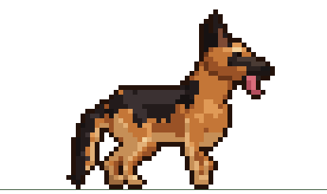
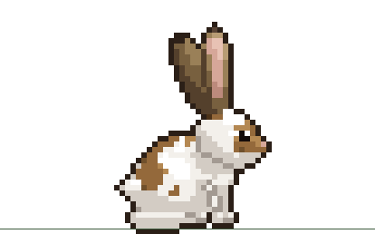
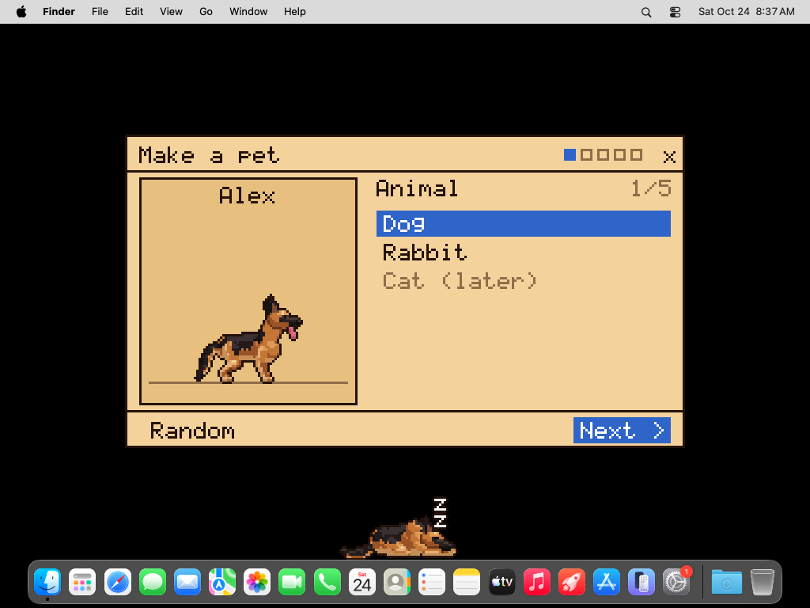
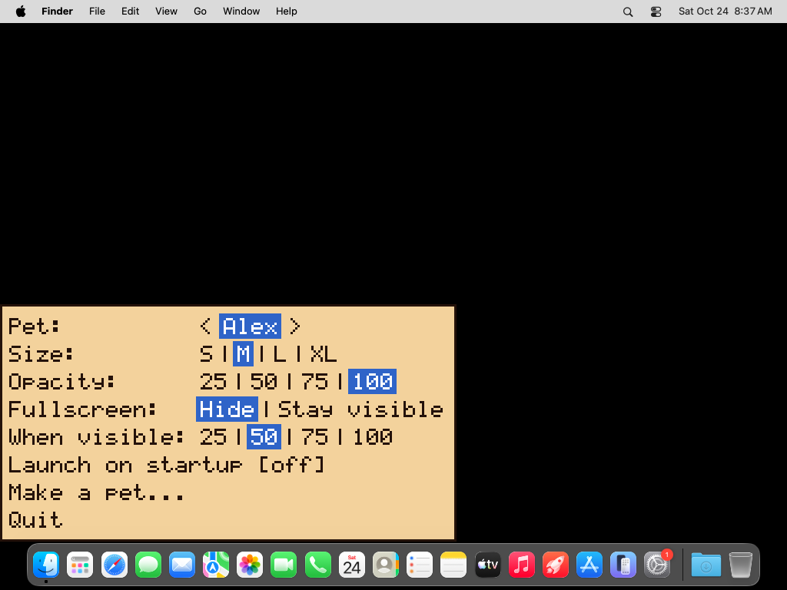

<p align="center">
  
  &nbsp;&nbsp;&nbsp;
  
</p>

<h1 align="center">PixelPet</h1>

<p align="center">A small pixel pet that lives on your desktop.<br>
<a href="https://rishi943.github.io/pixelpet/"><b>Website</b></a> ·
<a href="https://github.com/Rishi943/pixelpet/releases/latest"><b>Download</b></a></p>

PixelPet walks along the top of your taskbar or Dock, naps when you leave it alone, and can be petted, played with and fed. Clicks pass straight through the space around it, so it never gets in the way. It's one small file with no installer, no internet and no account.

## Download

| Windows | macOS | Linux |
|---|---|---|
| [PixelPet.exe](https://github.com/Rishi943/pixelpet/releases/latest/download/PixelPet.exe) | [PixelPet.dmg](https://github.com/Rishi943/pixelpet/releases/latest/download/PixelPet.dmg) (Intel and Apple Silicon) | [PixelPet-x86_64.AppImage](https://github.com/Rishi943/pixelpet/releases/latest/download/PixelPet-x86_64.AppImage) |

PixelPet isn't signed yet, so the first launch asks once:

- **Windows:** on "Windows protected your PC", click **More info**, then **Run anyway**.
- **macOS:** drag PixelPet to Applications. If it says it can't be opened, click **Done**, then go to **System Settings → Privacy & Security** and click **Open Anyway**.
- **Linux:** `chmod +x PixelPet-x86_64.AppImage`, then run it. It needs X11, or Wayland with XWayland.

## What it does

- **Pet, play, feed.** Hover over the pet to open its bubble. Throw a ball, coconut or football, or hand over a treat.
- **Make your own pet.** Pick a dog or a rabbit, then choose a breed, shape, coat and collar, and give it a name. Keep as many as you like.
- **Settings on right-click.** Switch pets, and set its size, opacity, what it does over fullscreen apps, and launch on startup.

| | |
|---|---|
|  |  |

## Building

```
cargo build --release
```

The binary is `target/release/PixelPet` (`PixelPet.exe` on Windows). See [docs/release.md](docs/release.md) for how the release downloads are built.
